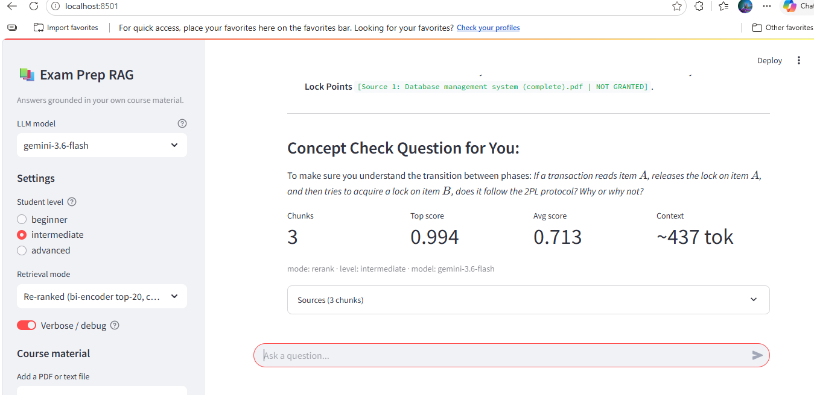
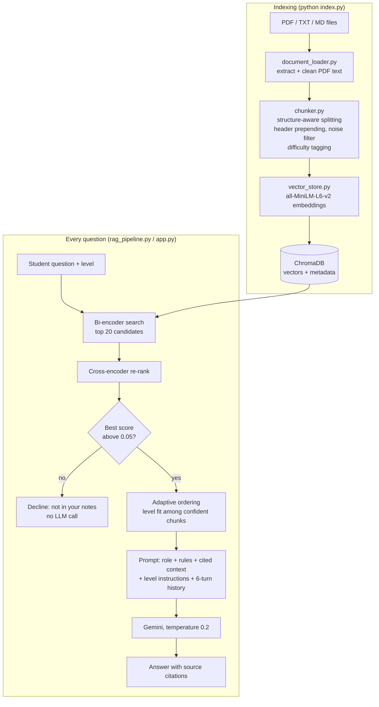

# Exam Prep RAG: Adaptive Exam Preparation Engine

A retrieval-augmented study assistant that answers questions from a student's own course notes, adapts what it retrieves to the student's level, and refuses questions the notes don't cover. Every component is written from scratch (no LangChain) and measured against a hand-labelled evaluation set.



---

## Highlights

| | |
|---|---|
| **Two-stage retrieval** | Bi-encoder (`all-MiniLM-L6-v2`) fetches 20 candidates, a cross-encoder (`ms-marco-MiniLM-L-6-v2`) re-ranks them. **+27% Recall@5** on the gold set. |
| **Adaptive retrieval** | Chunks are tagged basic / intermediate / advanced at index time. Beginners get more definitions (37% to 46% of retrieved chunks), advanced students more worked problems (13% to 18%). |
| **Refuses out-of-scope questions** | The cross-encoder's score separates answerable from unanswerable questions by a wide margin, so off-topic questions are declined **before** the LLM is called. 5/5 declined, 0 API calls. |
| **Honest evaluation** | 25 questions, 383 hand-graded chunks, nDCG / Recall / MRR, LLM-as-judge for answers, and an out-of-scope test. |
| **Noisy real data** | Runs on the author's handwritten GATE DBMS notes (184K characters of messy PDF extraction), not a clean demo file. |
| **Tested** | 74 unit tests (no API key or network needed). |

---

## Architecture



### Retrieval modes

| Mode | What it does | When to use it |
|---|---|---|
| `basic` | Top-k by cosine similarity | Baseline |
| `context` | Top-3 plus each hit's neighbouring chunks, in reading order | Long explanations split across chunks |
| `rerank` | Bi-encoder top 20, cross-encoder picks top 5 | Best relevance (default in the app) |
| `adaptive` | `rerank`, then level-aware ordering of confident chunks | Personalised to beginner / intermediate / advanced |

---

## Evaluation

All numbers come from `python evaluation.py` on the DBMS notes plus an algorithms control file (496 chunks).

### Retrieval against a hand-labelled gold set

The first version of the evaluation counted a chunk as relevant if it contained a topic keyword. Hit Rate and MRR came out at 1.00 for every method, so the metric could not tell retrievers apart. I replaced it with [`eval_gold.json`](eval_gold.json): for 25 questions, every chunk retrieved by either method (top 10 each) was graded **2** (answers the question), **1** (partially useful) or **0**, plus a keyword sweep of the whole index for relevant chunks both methods missed.

| Metric (k=5) | basic | rerank | change |
|---|---|---|---|
| nDCG@5 | 0.699 | 0.766 | +10% |
| **Recall@5** (grade-2 chunks found) | 0.480 | 0.611 | **+27%** |
| MRR | 0.870 | 0.863 | flat |
| Precision@5 (grade >= 1) | 0.808 | 0.824 | +2% |

Re-ranking wins on 14 of 25 questions and loses on 10; the average gain is driven by large wins (e.g. participation constraints 0.47 to 0.96, BCNF 0.60 to 1.00). With 25 questions this is a promising signal, not a proof. Latency: 30 ms per query for `basic`, about 1.3 s for `rerank` on CPU, small next to the LLM call.

### Adaptive retrieval by student level

| Level | basic chunks | advanced chunks | nDCG@5 | top 5 differs from rerank |
|---|---|---|---|---|
| beginner | **46%** | 7% | 0.728 | 9 / 25 questions |
| intermediate | 37% | 13% | 0.766 | 0 / 25 (same as rerank) |
| advanced | 30% | **18%** | 0.706 | 12 / 25 questions |

The small nDCG drop is the expected cost: the gold labels judge topic relevance only, and adaptive mode deliberately prefers a level-appropriate chunk over the single best topical match. The shift for advanced students is limited by the notes themselves: only 10 of 25 questions have any clearly relevant advanced chunk.

### Answer quality (LLM as judge, 1 to 5)

Answers generated in `rerank` mode with `gemini-flash-lite-latest`, then scored by the same model against the retrieved context and a list of reference points per question (25 questions).

| Metric | Score | Meaning |
|---|---|---|
| Faithfulness | **4.92** | Claims are supported by the retrieved notes (0 of 25 answers scored 3 or below) |
| Relevancy | **4.92** | The answer addresses the question |
| Completeness | **4.20** | Share of the reference points covered |

The model almost never goes beyond the notes; the weak spot is completeness (5 of 25 answers scored 3 or below). Cross-checking those against the gold set shows three different causes:

- **Retrieval miss** (EXISTS clause): only 1 of the 6 chunks that answer it reached the top 5 (Recall@5 = 0.17).
- **Thin notes** (tuple relational calculus): both relevant chunks were retrieved, but the notes only cover TRC briefly.
- **Generation** (ACID): 3 relevant chunks were retrieved, yet the answer only listed the acronym.

For reference, an earlier run in `basic` mode on the original index (15 questions) scored 4.80 / 4.73 / 3.80. The index, question set and mode all changed since then, so this is not a controlled comparison. Judge scores are best read as relative, since the judge and the generator are the same model family.

### Out-of-scope questions

Five questions the notes don't cover (extendible hashing, CAP theorem, Kubernetes, gradient descent, TCP handshake). "Extendible hashing" is a deliberate trap: it sounds like DBMS, but the notes have no hashing section.

| Mode | Declined | LLM calls |
|---|---|---|
| `rerank` / `adaptive` | **5 / 5** | **0** (blocked by the relevance guard) |
| `basic` | 4 / 5 by the judge | 10 |

Why the guard works: every answerable question's best chunk scored **at least 0.79** with the cross-encoder, every out-of-scope question's best chunk scored **below 0.001**. Cosine similarity cannot separate them (0.49 vs 0.35). The one `basic` "failure" did say the notes don't cover the CAP theorem, then padded with loosely related material, so it wasted a call rather than hallucinated.

---

## Design decisions

**No LangChain.** Each file maps to a LangChain component (table below), but writing them by hand is what made the bugs and trade-offs in this README visible. LangChain does the same in about 15 lines and hides all of it.

**Structure-aware chunking with header prepending.** Chunks are split inside detected sections and every chunk starts with its section header, so "the time complexity is O(n log n)" is embedded together with "Merge Sort". Header detection originally treated formulas and timestamps ("A = 1100", "6:29 PM") as headers in 54% of DBMS chunks; tightening the rules fixed that and raised Precision@5 from 0.76 to 0.80 (keyword metric).

**Content quality filter.** Chunks with fewer than 5 words or under 30% alphabetic characters are dropped. Handwritten notes produce table and diagram fragments that would otherwise pollute the embedding space.

**Two-stage retrieval.** A bi-encoder embeds query and chunk separately, which makes it fast enough to search everything but blind to word-level interactions. A cross-encoder reads them together and is far more accurate, but too slow for the whole index. Using the bi-encoder for recall and the cross-encoder for precision gets both.

**Adaptive ordering, not filtering.** Two simpler designs were measured and rejected. A hard metadata filter can discard the only chunk that answers the question. A score bonus for level-matched chunks dropped nDCG from 0.77 to 0.70 even at its smallest setting, because weakly relevant chunks jumped ahead. The final design only reorders chunks the cross-encoder scores at 0.9 or above, so level decides between relevant chunks and never promotes irrelevant ones.

**Rule-based difficulty tags.** Definition language ("is called", "types of") pushes a chunk towards basic; problem markers ("Q.", "sol.", "how many"), formula symbols and digits push it towards advanced. Rules are free, instant and explainable. On a blind check of 30 chunks they matched manual labels 63% of the time (33% by chance) and never confused basic with advanced.

**Temperature 0.2.** RAG answers should stay close to the retrieved text; higher temperature trades faithfulness for fluency.

**Sliding window of 6 turns.** Older history competes with retrieved context for the prompt budget. Summarising it would cost an extra API call per turn.

**ChromaDB over FAISS.** Metadata (source, section, difficulty) is stored next to the vectors. At ~500 chunks both are instant, so convenience wins.

**`all-MiniLM-L6-v2` embeddings.** 384 dimensions, local, free and fast. The re-ranker covers most of its accuracy gap; `all-mpnet-base-v2` would be the next upgrade.

### LangChain equivalents

| This project | LangChain |
|---|---|
| `document_loader.py` | `PyMuPDFLoader` |
| `chunker.py` | `RecursiveCharacterTextSplitter` |
| `vector_store.py` | `Chroma.from_documents()` |
| `Retriever.retrieve()` | `vectorstore.as_retriever()` |
| `Retriever.retrieve_with_reranking()` | `ContextualCompressionRetriever` + `CrossEncoderReranker` |
| `RAGPipeline` | `ConversationalRetrievalChain` |

---

## Setup

Requires Python 3.10+.

```bash
pip install -r requirements.txt

# Gemini API key (free at https://aistudio.google.com/apikey)
cp .env.example .env        # then paste your key into .env

# Build the index from ./data (PDF, TXT, MD)
python index.py             # add --yes to skip the chunk inspection pause
```

The first run downloads the embedding model (~90 MB) and, on first use of `rerank` / `adaptive`, the cross-encoder (~90 MB).

## Usage

```bash
streamlit run app.py                 # chat UI: upload files, pick level and mode, see sources

python rag_pipeline.py               # terminal chat (commands: level <x>, verbose, clear, quit)
python rag_pipeline.py --model gemini-flash-lite-latest

python query.py --mode rerank        # retrieval only, no API calls

python evaluation.py --retrieval-only --compare   # all retrieval tables, free
python evaluation.py --mode rerank                # full evaluation (about 50 API calls)
python evaluation.py --unanswerable-only --mode rerank

python -m pytest tests               # 74 tests, no API key needed
```

The free Gemini tier has a small daily request limit per model. If it runs out, switch to `gemini-flash-lite-latest` in the app's sidebar or with `--model`.

## Project structure

```
document_loader.py   PDF/text loading and PDF clean-up
chunker.py           section detection, chunking, quality filter, difficulty tags
vector_store.py      embeddings + ChromaDB
retriever.py         basic / context / rerank / adaptive retrieval, context formatting
rag_pipeline.py      prompt, LLM client (Gemini or OpenAI), history, relevance guard
app.py               Streamlit UI
index.py             indexing CLI
query.py             retrieval-only CLI
evaluation.py        retrieval, gold-set, generation and out-of-scope evaluation
eval_gold.json       hand-graded relevance labels (25 questions, 383 chunks)
eval_results.json    latest evaluation output
tests/               pytest suite
data/                course material
```

## Tech stack

Python, sentence-transformers (bi-encoder and cross-encoder), ChromaDB, PyMuPDF, Google Gemini API, Streamlit, pytest.

## Limitations and future work

- **Small evaluation set.** 25 labelled questions, labelled by one person. More questions and a second annotator would make the comparisons statistically solid.
- **Recall gaps remain.** For "how do you find the attribute closure", the chunks that actually define closure were missed by both retrievers. **Hybrid search** (BM25 + embeddings) should help with exact terms like "BCNF" and "2PL".
- **Query expansion / HyDE** for short or vague questions.
- **Page numbers in citations.** The loader currently merges pages, so answers cite the file and section but not the page.
- **Same-family judge.** Answers are judged by a Gemini model, which may favour Gemini answers. A judge from another provider would be more trustworthy.
- **SDK migration.** `google-generativeai` is deprecated in favour of `google-genai`.
